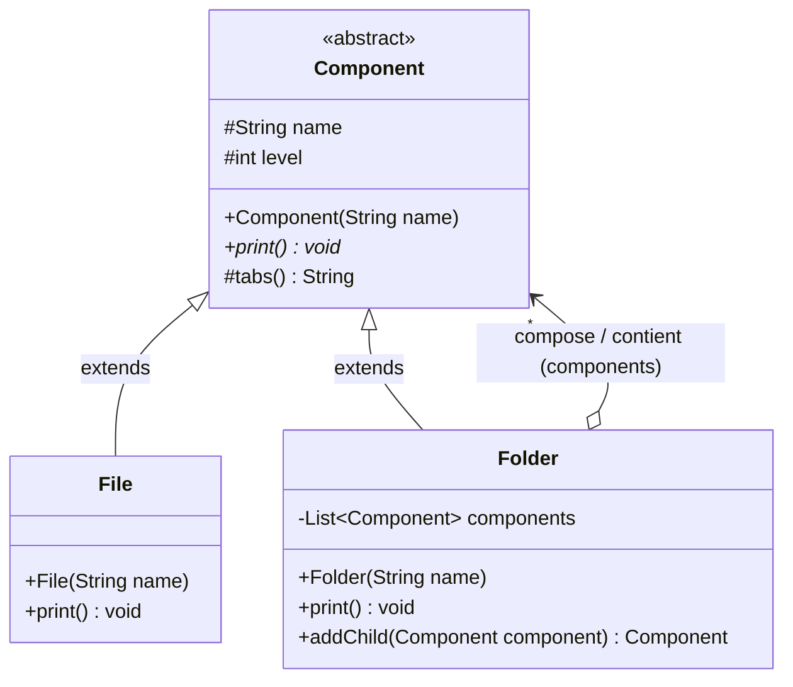
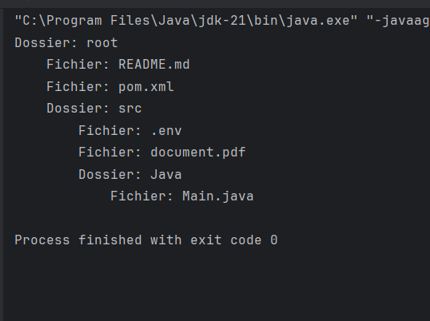

# Design Pattern Composite

Implémentation en Java du design pattern **Composite**, réalisée dans le cadre du TP2 de Design Patterns (ENSET Mohammedia).
Cette branche contient le pattern Composite ; les patterns Observer et Decorator sont traités sur leurs propres branches.

## Sommaire

- [Le pattern Composite](#le-pattern-composite)
- [Structure du projet](#structure-du-projet)
- [Diagramme de classes](#diagramme-de-classes)
- [Principe du pattern Composite](#principe-du-pattern-composite)
- [Programme de test](#programme-de-test)
- [Trace d'exécution](#trace-dexécution)
- [Exécution](#exécution)
- [Auteur](#auteur)

## Le pattern Composite

Composite est un pattern **structurel**. Il permet d'organiser les objets en structures arborescentes pour représenter des hiérarchies de type **partie-tout** (*part-whole hierarchies*).

Le pattern permet au code client de traiter de manière **uniforme** et transparente aussi bien les objets individuels (les feuilles, ou *Leaf*) que les compositions d'objets (les conteneurs, ou *Composite*) :
- Un composant abstrait (`Component`) définit l'interface commune aux éléments simples et composites.
- Une feuille (`Leaf`) implémente le comportement des éléments primitifs ne possédant pas d'enfants.
- Un composite (`Composite`) contient un ensemble d'enfants de type `Component` et leur propage récursivement les opérations demandées.
- Le client n'a pas à distinguer s'il manipule un élément simple ou un conteneur complexe : il invoque les mêmes méthodes sur l'abstraction commune.

Cas d'usage typiques : systèmes de fichiers (fichiers et répertoires), interfaces graphiques (widgets et panneaux conteneurs comme dans Swing ou JavaFX), arbres syntaxiques (AST dans les compilateurs), structures organisationnelles (employés et départements).

## Structure du projet

```
src/main/java/net/zoungrana/composite
├── Component.java     composant abstrait de base (Component)
├── File.java          élément feuille représentant un fichier (Leaf)
├── Folder.java        élément composite représentant un dossier (Composite)
└── Main.java          programme de test construisant et affichant l'arborescence
```

| Élément | Type GoF | Rôle |
|---|---|---|
| `Component` | *Component* | Classe abstraite définissant les attributs protégés `name` (nom de l'élément) et `level` (niveau de profondeur dans l'arborescence), la méthode utilitaire `tabs()` pour l'indentation, et la méthode abstraite `print()`. |
| `File` | *Leaf* | Élément primitif (fichier). Il ne possède pas d'enfants. Il redéfinit `print()` pour afficher son nom précédé du nombre de tabulations correspondant à son niveau : `tabs() + "Fichier: " + name`. |
| `Folder` | *Composite* | Élément conteneur (dossier). Maintient une collection `List<Component> components`. Redéfinit `print()` pour afficher son nom (`tabs() + "Dossier: " + name`) et déléguer récursivement `print()` à tous ses composants enfants. Fournit la méthode `addChild(Component)` qui incrémente la profondeur (`component.level = this.level + 1`). |
| `Main` | *Client* | Construit une hiérarchie arborescente complète de dossiers et fichiers (`root`, `src`, `Java`, etc.) et déclenche l'affichage récursif global via `root.print()`. |

## Diagramme de classes




Lecture du diagramme :

- **`Component` est l'abstraction centrale (`Component`)** : il déclare le contrat partagé par tous les nœuds de l'arbre (`name`, `level`, `tabs()` et la méthode abstraite `print()`).
- **`File` hérite de `Component` (`extends Component`)** : c'est la feuille (*Leaf*). Elle ne contient aucun sous-composant et constitue le cas de base (arrêt) de la récursion lors de l'exécution de `print()`.
- **`Folder` hérite de `Component` (`is-a`)** : il s'agit du conteneur (*Composite*). En héritant de `Component`, un dossier est lui-même un `Component`. Cela permet d'imbriquer des dossiers dans d'autres dossiers à n'importe quel niveau de profondeur.
- **`Folder` compose plusieurs `Component` (`has-a`, multiplicité `*`)** : grâce à l'association `components : List<Component>`, un dossier peut contenir aussi bien des fichiers simples (`File`) que d'autres dossiers (`Folder`), sans jamais se préoccuper de leur type concret.
- **`Main` est le client** : il interagit avec la structure via la racine de l'arborescence et bénéficie du polymorphisme : un seul appel à `root.print()` affiche l'ensemble de l'arborescence de façon structurée.

## Principe du pattern Composite

### 1. Pourquoi le pattern Composite ? (Le problème de la non-uniformité)

Dans une approche classique sans design pattern, la distinction entre fichiers et dossiers forcerait le code client à gérer deux types d'objets distincts et des structures de données séparées :

```java
// Approche naïve sans pattern : couplage fort et vérifications manuelles
if (item instanceof Folder) {
    Folder folder = (Folder) item;
    // parcourir les sous-dossiers et les sous-fichiers séparément...
} else if (item instanceof File) {
    // traiter le fichier simple...
}
```

Cette approche présente des inconvénients majeurs :
- Le code client est encombré de tests de type (`instanceof`) et de conversions explicites.
- Toute évolution (par exemple l'ajout de liens symboliques `Symlink` ou d'archives `ZipArchive`) obligerait à modifier tous les algorithmes de parcours existants, violant le principe **Open/Closed (OCP)**.

### 2. La solution par composition récursive

Le pattern Composite unifie les objets simples et composites sous une même abstraction :
- **Transparence et uniformité** : un dossier traite tous ses enfants via le type polymorphique `Component`. Pour afficher son contenu, il appelle simplement `Component::print` sur chaque élément de sa liste.
- **Récursion naturelle** : si le composant enfant est un `File`, il s'affiche et l'appel se termine. S'il s'agit d'un `Folder`, il s'affiche puis délègue à son tour l'appel `print()` à ses propres enfants, déroulant un parcours récursif en profondeur (*depth-first traversal*) de façon totalement autonome et décentralisée.

### 3. Gestion de la profondeur et de l'indentation

Chaque nœud de l'arbre maintient un attribut protégé `level` :
1. La racine est initialisée avec `level = 0`.
2. Lors de l'appel à `folder.addChild(component)`, le niveau de l'enfant est automatiquement calculé :
   ```java
   public Component addChild(Component component) {
       component.level = this.level + 1;
       components.add(component);
       return component;
   }
   ```
3. La méthode utilitaire `tabs()` génère dynamiquement la chaîne d'indentation (`\t` répétée `level` fois), produisant un affichage hiérarchique visuel de l'arborescence.

### 4. Transparence vs Sécurité

Le catalogue GoF identifie deux variantes d'implémentation pour les méthodes de gestion des enfants (`addChild`, `removeChild`, `getChildren`) :
- **Transparence maximale** : déclarer `addChild` directement dans `Component`. Tous les composants ont alors exactement la même interface, mais les feuilles (`File`) doivent lever une exception ou ne rien faire si on essaie de leur ajouter un enfant.
- **Sécurité maximale (choix retenu ici)** : déclarer `addChild` uniquement dans la classe `Folder`. Ainsi, il est impossible à la compilation d'ajouter un enfant à un `File`. La méthode `addChild` retourne en outre le `Component` ajouté, facilitant la composition fluide.

| Critère | Approche procédurale classique | Pattern Composite |
|---|---|---|
| Traitement client | Différencié (cas particulier pour chaque type) | Uniforme via l'abstraction `Component` |
| Couplage | Fort (connaissance de toutes les classes concrètes) | Faible (dépendance envers `Component`) |
| Parcours arborescent | Algorithme externe et impératif | Délégation récursive intrinsèque aux objets |
| Extensibilité (OCP) | Difficile (nécessite d'adapter les parcours) | Excellente (ajout de nouveaux composants sans modification) |

## Programme de test

La classe `net.zoungrana.composite.Main` construit une arborescence de répertoires et fichiers sur 4 niveaux, puis déclenche l'affichage global :

```java
package net.zoungrana.composite;

public class Main {
    public static void main(String[] args) {
        Folder root = new Folder("root");
        root.addChild(new File("README.md"));
        root.addChild(new File("pom.xml"));

        Folder src = (Folder) root.addChild(new Folder("src"));
        src.addChild(new File(".env"));
        src.addChild(new File("document.pdf"));
        Folder java = (Folder) src.addChild(new Folder("Java"));
        java.addChild(new File("Main.java"));
        
        root.print();
    }
}
```

Structure de l'arbre ainsi créé :
```
root/ (Folder, level 0)
├── README.md (File, level 1)
├── pom.xml (File, level 1)
└── src/ (Folder, level 1)
    ├── .env (File, level 2)
    ├── document.pdf (File, level 2)
    └── Java/ (Folder, level 2)
        └── Main.java (File, level 3)
```

## Trace d'exécution



```text
Dossier: root
	Fichier: README.md
	Fichier: pom.xml
	Dossier: src
		Fichier: .env
		Fichier: document.pdf
		Dossier: Java
			Fichier: Main.java

Process finished with exit code 0
```

| Niveau (`level`) | Indentation | Élément affiché | Type dynamique | Remarque |
|:---:|---|---|---|---|
| **0** | Aucune (`""`) | `Dossier: root` | `Folder` | Nœud racine de l'arborescence. |
| **1** | 1 tabulation (`\t`) | `Fichier: README.md` | `File` | Enfant direct de `root`. |
| **1** | 1 tabulation (`\t`) | `Fichier: pom.xml` | `File` | Enfant direct de `root`. |
| **1** | 1 tabulation (`\t`) | `Dossier: src` | `Folder` | Sous-dossier, propage la récursion à ses composants. |
| **2** | 2 tabulations (`\t\t`) | `Fichier: .env` | `File` | Enfant direct de `src`. |
| **2** | 2 tabulations (`\t\t`) | `Fichier: document.pdf` | `File` | Enfant direct de `src`. |
| **2** | 2 tabulations (`\t\t`) | `Dossier: Java` | `Folder` | Sous-dossier de `src`, propage la récursion. |
| **3** | 3 tabulations (`\t\t\t`) | `Fichier: Main.java` | `File` | Feuille au niveau de profondeur le plus profond. |

Points vérifiés par cette trace :

- **Traitement uniforme** : l'instruction unique `root.print()` a parcouru l'intégralité de l'arborescence sans aucune boucle explicite ni test de type dans le code client.
- **Récursion en profondeur** : les dossiers délèguent l'appel `print()` à leurs enfants dans l'ordre d'insertion, explorant récursivement chaque sous-branche avant de passer à l'élément suivant.
- **Exactitude de l'indentation** : le calcul incrémental de `level` dans `addChild` garantit une mise en page fidèle à la hiérarchie physique du système de fichiers.

## Exécution

Prérequis : JDK 21 et Maven.

Compilation du projet :
```bash
mvn compile
```

Lancement du programme de test du pattern Composite :
```bash
java -cp target/classes net.zoungrana.composite.Main
```

Le projet peut également être ouvert dans IntelliJ IDEA et exécuté directement depuis la classe `net.zoungrana.composite.Main`.

## Auteur

Charly ZOUNGRANA — Élève ingénieur en Génie Logiciel et Systèmes Informatiques Distribués, ENSET Mohammedia.
