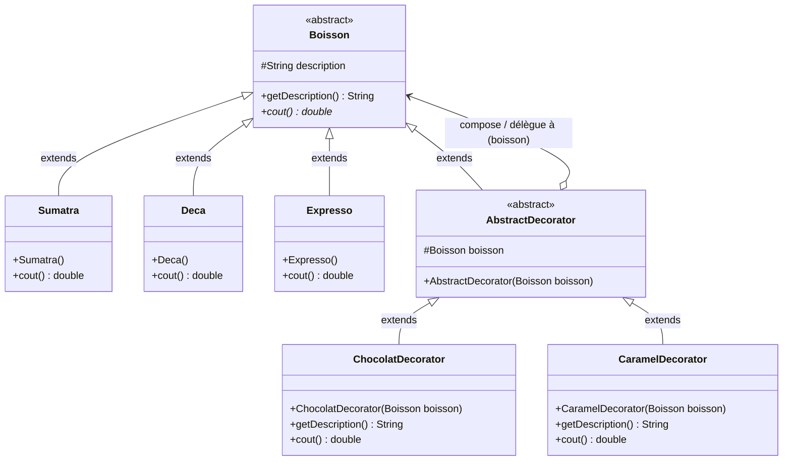
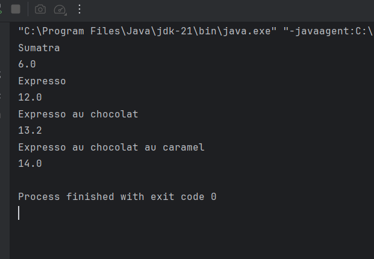

# Design Pattern Decorator

Implémentation en Java du design pattern **Decorator**, réalisée dans le cadre du TP2 de Design Patterns (ENSET Mohammedia).
Cette branche contient le pattern Decorator ; les patterns Observer et Composite sont traités sur leurs propres branches.

## Sommaire

- [Le pattern Decorator](#le-pattern-decorator)
- [Structure du projet](#structure-du-projet)
- [Diagramme de classes](#diagramme-de-classes)
- [Principe de la décoration dynamique](#principe-de-la-décoration-dynamique)
- [Programme de test](#programme-de-test)
- [Trace d'exécution](#trace-dexécution)
- [Exécution](#exécution)
- [Auteur](#auteur)

## Le pattern Decorator

Decorator est un pattern **structurel**. Il permet d'ajouter dynamiquement de nouvelles responsabilités ou fonctionnalités à un objet sans modifier sa structure interne ni impacter les autres instances de la même classe.

Plutôt que d'utiliser l'héritage statique — qui conduirait à une explosion combinatoire du nombre de sous-classes pour chaque combinaison possible de fonctionnalités —, le pattern Decorator privilégie la **composition** et la **délégation** :
- Un objet décorateur enveloppe (*wrap*) l'objet cible.
- Le décorateur implémente la même interface que l'objet qu'il enveloppe, le rendant transparent pour le code client.
- Le décorateur délègue les requêtes à l'objet enveloppé tout en exécutant des traitements additionnels avant ou après.
- Les décorateurs peuvent ainsi **s'empiler de façon récursive**.

Cas d'usage typiques : flux d'entrée/sortie Java (`InputStream`, `BufferedInputStream`, `GZIPInputStream`), interfaces graphiques (ajout de bordures ou ascenseurs à un composant), systèmes de tarification ou de facturation à options cumulatives (comme le cas des boissons et suppléments).

## Structure du projet

```
src/main/java/net/zoungrana/decorator
├── components/
│   ├── Boisson.java          composant abstrait de base (Component)
│   ├── Deca.java             composant concret : Déca (coût: 8.0)
│   ├── Expresso.java         composant concret : Expresso (coût: 12.0)
│   └── Sumatra.java          composant concret : Sumatra (coût: 6.0)
├── AbstractDecorator.java    décorateur abstrait (hérite de Boisson et compose une Boisson)
├── CaramelDecorator.java     décorateur concret : supplément Caramel (+0.8)
├── ChocolatDecorator.java    décorateur concret : supplément Chocolat (+1.2)
└── Main.java                 programme de test démontrant l'empilement
```

| Élément | Type GoF | Rôle |
|---|---|---|
| `Boisson` | *Component* | Classe abstraite définissant l'attribut protégé `description`, son getter `getDescription()`, et la méthode abstraite `cout()`. |
| `Expresso` | *ConcreteComponent* | Café Expresso de base (`cout() = 12.0`, description = `"Expresso"`). |
| `Deca` | *ConcreteComponent* | Café Déca de base (`cout() = 8.0`, description = `"Deca"`). |
| `Sumatra` | *ConcreteComponent* | Café Sumatra de base (`cout() = 6.0`, description = `"Sumatra"`). |
| `AbstractDecorator` | *Decorator* | Classe abstraite qui hérite de `Boisson` et possède une référence vers une `Boisson` (`protected Boisson boisson`). Cette double relation permet de décorer aussi bien un composant de base qu'un autre décorateur. |
| `ChocolatDecorator` | *ConcreteDecorator* | Décorateur ajoutant du chocolat : redéfinit `getDescription()` (`+ " au chocolat"`) et `cout()` (`+ 1.2`). |
| `CaramelDecorator` | *ConcreteDecorator* | Décorateur ajoutant du caramel : redéfinit `getDescription()` (`+ " au caramel"`) et `cout()` (`+ 0.8`). |
| `Main` | *Client* | Programme principal démontrant la création de boissons et l'empilement récursif des décorateurs. |

## Diagramme de classes




Lecture du diagramme :

- **`Sumatra`, `Deca` et `Expresso` héritent de `Boisson`** : ce sont les composants de base (*Concrete Components*). Ils fournissent une implémentation directe de `cout()` et fixent leur description dans leur constructeur.
- **`AbstractDecorator` hérite de `Boisson` (`is-a`)** : cette relation d'héritage garantit la conformité de type. Un décorateur *est une* `Boisson`. Il peut donc être manipulé partout où une `Boisson` est attendue.
- **`AbstractDecorator` compose une `Boisson` (`has-a`)** : l'attribut `protected Boisson boisson` permet au décorateur de conserver une référence vers l'objet qu'il enveloppe pour lui déléguer les appels.
- **Permettre la décoration d'un décorateur** : c'est la combinaison de ces deux relations (`extends Boisson` et `Boisson boisson`) qui rend possible la récursion. Comme `AbstractDecorator` hérite de `Boisson`, une instance de décorateur peut elle-même être passée au constructeur d'un autre décorateur (`CaramelDecorator` décorant un `ChocolatDecorator` décorant un `Expresso`).
- **`ChocolatDecorator` et `CaramelDecorator` héritent d'`AbstractDecorator`** : ils fournissent le comportement additionnel en surchargeant `getDescription()` et `cout()`.

## Principe de la décoration dynamique

### 1. Pourquoi pas l'héritage classique ? (Explosion combinatoire)

Si l'on voulait représenter chaque combinaison de boisson et d'ingrédients à l'aide de l'héritage classique, il faudrait créer une classe pour chaque possibilité :
- `ExpressoChocolat`, `ExpressoCaramel`, `ExpressoChocolatCaramel`
- `DecaChocolat`, `DecaCaramel`, `DecaChocolatCaramel`
- `SumatraChocolat`, `SumatraCaramel`, `SumatraChocolatCaramel`

Avec $N$ boissons et $M$ suppléments, le nombre de classes nécessaires explose selon la formule :
$$\text{Nombre de classes} = N \times 2^M$$

Si l'on ajoute un troisième ingrédient (ex: *Lait*), le nombre de sous-classes double immédiatement. De plus, l'héritage statique rend impossible l'ajout d'ingrédients en double (ex: double caramel) sans créer encore de nouvelles classes.

### 2. La solution par composition récursive

Le pattern Decorator résout ce problème en séparant les composants de base des décorateurs :
- Le nombre de classes nécessaires devient linéaire : $N + M$ classes seulement.
- Les suppléments sont ajoutés dynamiquement à l'exécution en empilant les objets comme des poupées russes.
- Le principe **Open/Closed (OCP)** est strictement respecté : pour ajouter une nouvelle boisson (ex: `Cappuccino`) ou un nouvel ingrédient (ex: `Cannelle`), il suffit de créer une nouvelle classe sans toucher au code existant.

### 3. Fonctionnement de la délégation récursive

Lorsqu'on demande le coût d'une boisson décorée, l'appel traverse la chaîne de composition de l'extérieur vers l'intérieur :

```
Client -> CaramelDecorator.cout()
              │
              ├──> retourne 0.8 + boisson.cout()
                                      │
                                      └──> ChocolatDecorator.cout()
                                                │
                                                ├──> retourne 1.2 + boisson.cout()
                                                                        │
                                                                        └──> Expresso.cout()
                                                                                  │
                                                                                  └──> retourne 12.0
```

Le calcul se dénoue alors en remontant :
$$\text{coût final} = 0.8 + (1.2 + 12.0) = 14.0\text{ DH}$$

Il en va de même pour `getDescription()` :
$$\text{description} = \text{"Expresso"} + \text{" au chocolat"} + \text{" au caramel"}$$

| Critère | Héritage statique | Pattern Decorator |
|---|---|---|
| Liaison | À la compilation (statique) | À l'exécution (dynamique) |
| Nombre de classes | Exponentiel ($N \times 2^M$) | Linéaire ($N + M$) |
| Flexibilité | Faible (combinaisons figées dans le code) | Maximale (combinaisons arbitraires et cumulables) |
| Répétition d'ingrédients | Difficile sans multiplier les classes | Naturelle (ex: double chocolat par ré-emballage) |
| Couplage client | Élevé (doit instancier la sous-classe exacte) | Faible (manipule uniquement l'abstraction `Boisson`) |

## Programme de test

La classe `net.zoungrana.decorator.Main` démontre l'instanciation de boissons simples, puis l'emballage dynamique progressif :

```java
package net.zoungrana.decorator;

import net.zoungrana.decorator.components.Boisson;
import net.zoungrana.decorator.components.Expresso;
import net.zoungrana.decorator.components.Sumatra;

public class Main {

    public static void main(String[] args) {

        Boisson boisson;
        boisson = new Sumatra();
        System.out.println(boisson.getDescription());
        System.out.println(boisson.cout());

        boisson = new Expresso();
        System.out.println(boisson.getDescription());
        System.out.println(boisson.cout());

        boisson = new ChocolatDecorator(boisson);
        System.out.println(boisson.getDescription());
        System.out.println(boisson.cout());

        boisson = new CaramelDecorator(boisson);
        System.out.println(boisson.getDescription());
        System.out.println(boisson.cout());
    }
}
```

Fonctionnement du code :
1. `boisson` est déclarée avec le type abstrait `Boisson`.
2. On instancie un `Sumatra` simple, puis on affiche sa description et son coût (6.0).
3. On remplace par un `Expresso` simple (12.0).
4. On décore cet expresso avec un `ChocolatDecorator` : la même variable `boisson` reçoit la référence de l'objet décoré.
5. On décore une seconde fois avec un `CaramelDecorator` : `CaramelDecorator` enveloppe le `ChocolatDecorator`, illustrant la décoration récursive d'un décorateur.

## Trace d'exécution



```text
Sumatra
6.0
Expresso
12.0
Expresso au chocolat
13.2
Expresso au chocolat au caramel
14.0

Process finished with exit code 0
```

| Étape | Code exécuté | Type dynamique | `getDescription()` | `cout()` | Analyse |
|---|---|---|---|---|---|
| 1 | `boisson = new Sumatra();` | `Sumatra` | `Sumatra` | `6.0` | Boisson de base simple sans supplément. |
| 2 | `boisson = new Expresso();` | `Expresso` | `Expresso` | `12.0` | Nouvelle boisson de base simple. |
| 3 | `boisson = new ChocolatDecorator(boisson);` | `ChocolatDecorator` | `Expresso au chocolat` | `13.2` | Enveloppe l'`Expresso` : `12.0 + 1.2 = 13.2`. Description enrichie. |
| 4 | `boisson = new CaramelDecorator(boisson);` | `CaramelDecorator` | `Expresso au chocolat au caramel` | `14.0` | **Décoration d'un décorateur** : enveloppe `ChocolatDecorator` (`13.2 + 0.8 = 14.0`). |

Points vérifiés par cette trace :

- **Transparence polymorphique** : la variable `boisson` reste typée `Boisson` tout au long du programme ; le client invoque toujours les mêmes méthodes (`getDescription()`, `cout()`).
- **Délégation et cumul des coûts** : chaque décorateur ajoute sa propre part tarifaire au résultat de la méthode `cout()` de la boisson qu'il contient.
- **Enrichissement de la description** : les descriptions sont concaténées de façon cohérente selon l'ordre d'application des décorateurs.
- **Composition récursive** : la décoration d'un décorateur (`CaramelDecorator` qui enveloppe `ChocolatDecorator`) fonctionne sans aucune ambiguïté grâce à la double relation d'`AbstractDecorator`.

## Exécution

Prérequis : JDK 21 et Maven.

Compilation du projet :
```bash
mvn compile
```

Lancement du programme de test Decorator :
```bash
java -cp target/classes net.zoungrana.decorator.Main
```

Le projet peut également être ouvert dans IntelliJ IDEA et exécuté directement depuis la classe `net.zoungrana.decorator.Main`.

## Auteur

Charly ZOUNGRANA — Élève ingénieur en Génie Logiciel et Systèmes Informatiques Distribués, ENSET Mohammedia.
