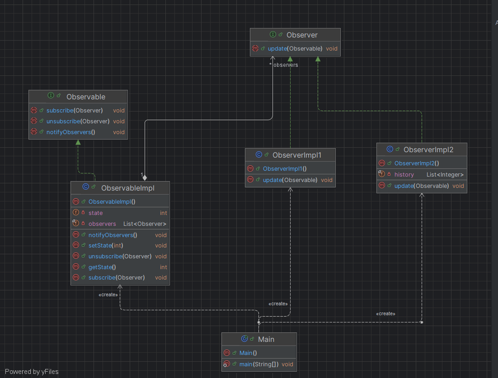
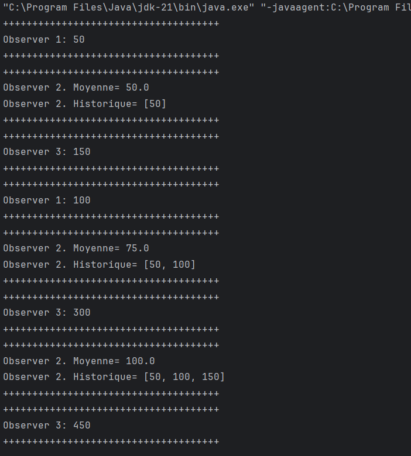

# Design Pattern Observer

Implémentation en Java du design pattern **Observer**, réalisée dans le cadre du TP2 de Design Patterns (ENSET Mohammedia).
Cette branche contient le pattern Observer ; les patterns Decorator et Composite sont traités sur leurs propres branches.

## Sommaire

- [Le pattern Observer](#le-pattern-observer)
- [Structure du projet](#structure-du-projet)
- [Diagramme de classes](#diagramme-de-classes)
- [Push et Pull](#push-et-pull)
- [Programme de test](#programme-de-test)
- [Trace d'exécution](#trace-dexécution)
- [Exécution](#exécution)

## Le pattern Observer

Observer est un pattern **comportemental**. Il définit une dépendance de type un-à-plusieurs entre objets : lorsqu'un objet
(l'*observable*, ou *sujet*) change d'état, tous les objets qui en dépendent (les *observateurs*) sont prévenus et mis à jour
automatiquement.

Le sujet ne connaît ses observateurs qu'à travers une interface commune. On peut donc ajouter ou retirer des observateurs à
l'exécution sans modifier le code du sujet : le couplage entre les deux reste faible.

Cas d'usage typiques : interfaces graphiques (écouteurs d'événements), systèmes de notification, tableaux de bord qui
réagissent à des données changeantes.

## Structure du projet

```
src/main/java/net/zoungrana/observer
├── Observable.java       interface du sujet
├── ObservableImpl.java   sujet concret, porte l'état
├── Observer.java         interface des observateurs
├── ObserverImpl1.java    affiche l'état reçu
├── ObserverImpl2.java    calcule la moyenne et l'historique des états
└── Main.java             programme de test
```

| Élément | Rôle |
|---|---|
| `Observable` | Déclare `subscribe(Observer)`, `unsubscribe(Observer)` et `notifyObservers()`. |
| `ObservableImpl` | Maintient la liste des observateurs et l'état `state`. `setState(int)` met à jour l'état puis déclenche `notifyObservers()`. |
| `Observer` | Interface fonctionnelle (`@FunctionalInterface`) avec une seule méthode `update(Observable)`. Un observateur peut donc être écrit sous forme de lambda. |
| `ObserverImpl1` | Affiche l'état courant. |
| `ObserverImpl2` | Conserve un historique (100 valeurs maximum) et affiche la moyenne des états reçus. |

## Diagramme de classes



Lecture du diagramme :

- **`ObservableImpl` implémente `Observable`** (flèche pointillée vers l'interface).
- **`ObservableImpl` agrège plusieurs `Observer`** : l'association `1 —— * observers` correspond à l'attribut
  `List<Observer> observers`. Le sujet dépend uniquement de l'interface, jamais des classes concrètes.
- **`ObserverImpl1` et `ObserverImpl2` implémentent `Observer`** et redéfinissent `update(Observable)`.
- **`ObserverImpl2` possède un état propre** (`history : List<Integer>`), ce qui montre qu'un observateur peut avoir sa
  propre logique, indépendante des autres.
- **`Main` crée** (`«create»`) le sujet et les observateurs concrets ; c'est lui qui les relie via `subscribe`.

Le diagramme correspond à la version **pull** du pattern (signature `update(Observable)`).

## Push et Pull

Le pattern admet deux façons de transmettre l'information aux observateurs. Les deux ont été implémentées, chacune dans un
commit distinct de cette branche.

### Push

Le sujet **envoie directement la nouvelle valeur** lors de la notification.

```java
// Observer
void update(int newState);

// ObservableImpl
public void notifyObservers() {
    observers.forEach(observer -> observer.update(state));
}
```

L'observateur reçoit la donnée sans avoir à interroger le sujet. En contrepartie, l'interface `Observer` est figée sur le
type de donnée transmis : si l'état évolue (nouveaux champs, autre type), la signature de `update` doit changer pour tous
les observateurs.

### Pull

Le sujet **envoie une référence vers lui-même**. C'est l'observateur qui décide quoi récupérer, et quand.

```java
// Observer
void update(Observable o);

// ObservableImpl
public void notifyObservers() {
    observers.forEach(observer -> observer.update(this));
}

// ObserverImpl1
public void update(Observable o) {
    if (o instanceof ObservableImpl obs) {
        System.out.println("Observer 1: " + obs.getState());
    }
}
```

L'interface `Observer` reste stable même si l'état du sujet s'enrichit, et chaque observateur ne lit que ce dont il a
besoin. En contrepartie, l'observateur doit connaître le type concret du sujet pour accéder à son état (ici via le
*pattern matching* `instanceof ObservableImpl obs`, Java 16+).

| | Push | Pull |
|---|---|---|
| Paramètre de `update` | la valeur (`int newState`) | le sujet (`Observable o`) |
| Qui choisit les données | le sujet | l'observateur |
| Évolution de l'état | modifie l'interface `Observer` | interface inchangée |
| Couplage observateur → sujet | faible | dépend du type concret du sujet |

La version actuellement présente sur la branche est la version **pull**.

## Programme de test

`Main` crée un sujet, abonne trois observateurs, puis modifie l'état :

```java
ObservableImpl observable = new ObservableImpl();
Observer observer1 = new ObserverImpl1();
Observer observer2 = new ObserverImpl2();

Stream.of(observer1, observer2).forEach(observable::subscribe);

// Troisième observateur défini par une lambda
observable.subscribe(o -> {
    if (o instanceof ObservableImpl obs) {
        System.out.println("Observer 3: " + obs.getState() * 3);
    }
});

observable.setState(50);
observable.setState(100);

observable.unsubscribe(observer1);

observable.setState(150);
```

Le troisième observateur n'a pas de classe dédiée : comme `Observer` est une interface fonctionnelle, une lambda suffit.

## Trace d'exécution



| Action | Observer 1 | Observer 2 | Observer 3 |
|---|---|---|---|
| `setState(50)` | `50` | moyenne `50.0`, historique `[50]` | `150` |
| `setState(100)` | `100` | moyenne `75.0`, historique `[50, 100]` | `300` |
| `unsubscribe(observer1)` | — | — | — |
| `setState(150)` | *(désabonné)* | moyenne `100.0`, historique `[50, 100, 150]` | `450` |

Points vérifiés par cette trace :

- chaque appel à `setState` notifie **tous** les observateurs abonnés, dans l'ordre d'abonnement ;
- chaque observateur applique **sa propre logique** à partir du même état (affichage, moyenne, multiplication par 3) ;
- après `unsubscribe(observer1)`, Observer 1 **ne reçoit plus** de notification, alors que les autres continuent
  normalement, sans qu'aucune modification du sujet n'ait été nécessaire.

## Exécution

Prérequis : JDK 21 et Maven.

```bash
mvn compile
java -cp target/classes net.zoungrana.observer.Main
```

Le projet peut aussi être ouvert dans IntelliJ IDEA et lancé depuis la classe `net.zoungrana.observer.Main`.

## Auteur

Charly ZOUNGRANA — Élève ingénieur en Génie Logiciel et Systèmes Informatiques Distribués, ENSET Mohammedia.
